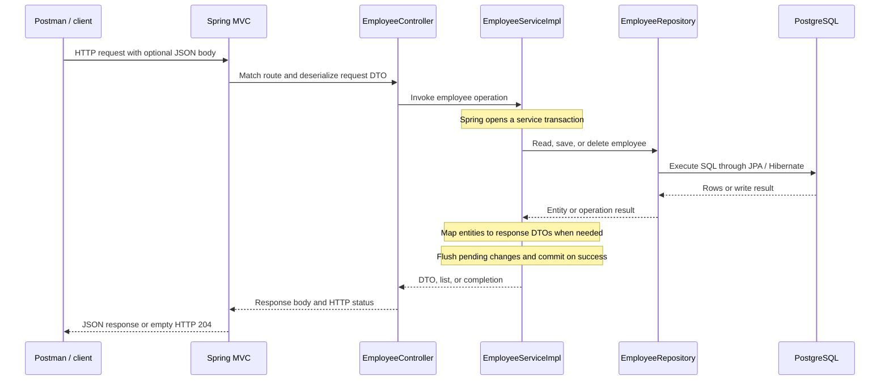
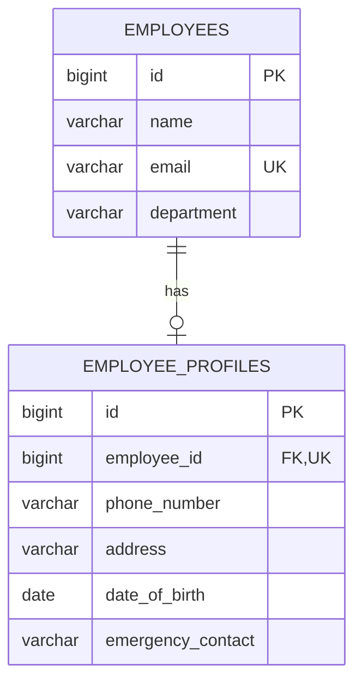

# Employee one-to-one API

The application uses PostgreSQL configured in `src/main/resources/application.properties` and listens on port 8082. An employee can have one optional profile. Deleting a profile keeps the employee; deleting an employee also deletes its profile.

| Method | Path | Behavior |
| --- | --- | --- |
| POST | /api/v1/employees | Create employee with optional profile (201) |
| GET | /api/v1/employees | List employees (200) |
| GET | /api/v1/employees/{id} | Get employee (200, or 404) |
| PUT | /api/v1/employees/{id}/profile | Create or replace profile fields (200, or 404) |
| DELETE | /api/v1/employees/{id}/profile | Remove profile (204, or 404 for missing employee) |
| DELETE | /api/v1/employees/{id} | Delete employee and profile (204, or 404) |

POST example:

```json
{
  "name": "Alex",
  "email": "alex@example.com",
  "department": "Engineering",
  "employeeProfileDto": {
    "phoneNumber": "1234567890",
    "address": "Hyderabad",
    "dateOfBirth": "1995-04-12",
    "emergencyContact": "9876543210"
  }
}
```

PUT accepts just the nested profile object. The old request spellings `phoneNumebr` and `dataOfBirth` remain accepted. Responses include employee IDs and profile details under `employeeProfileResponse`. Duplicate email creation returns 409.

Run `mvn test` for database-backed lifecycle tests using an isolated H2 database; PostgreSQL is not required for tests. Run `mvn spring-boot:run` to start the application against configured PostgreSQL.

## Execution flow

### Application startup

1. `OneToOneApplication.main()` calls `SpringApplication.run()`.
2. Spring Boot loads `application.properties`, including port `8082`, the PostgreSQL connection settings, and the password from `DB_PASSWORD`.
3. Component scanning registers the controller, service, exception handler, and Spring Data repositories. Constructor injection connects the controller to `EmployeeServiceImpl` and the service to `EmployeeRepository`.
4. Hibernate maps `Employee` and `EmployeeProfile` to their tables and updates the schema according to `spring.jpa.hibernate.ddl-auto=update`. PostgreSQL and the configured database must already be available.
5. Once startup completes, the application accepts requests under `/api/v1/employees`.

### Request and response path



The service uses `@Transactional`; read methods use `readOnly = true`. Profile details are mapped to response DTOs inside the service transaction, so lazy associations can be accessed during mapping. Entities are not returned directly to the client, avoiding recursive serialization of the bidirectional relationship. `saveAndFlush()` sends pending changes to the database before mapping the saved response; the transaction commits when the service invocation completes successfully.

### How the one-to-one relationship works



- `EmployeeProfile` owns the relationship: its `employee_id` column references `employees.id` and is both non-null and unique. Every profile belongs to exactly one employee, and an employee can have at most one profile.
- `Employee.employeeProfile` is the inverse side, declared with `mappedBy = "employee"`. An employee may exist without a profile.
- `Employee.setEmployeeProfile()` synchronizes both Java references. This ensures the owning profile has its employee reference before persistence.
- `CascadeType.ALL` propagates persistence operations from employee to profile. `orphanRemoval = true` deletes a profile when it is removed from the employee relationship.
- Employee and profile IDs are generated independently; they do not need to be equal.

### Flow for each operation

| Operation | Service execution | Result |
| --- | --- | --- |
| Create employee | Check `existsByEmail()`, populate the employee, optionally build and link its profile, then call `saveAndFlush()` and map the saved entities. | Employee and optional profile are saved together; HTTP 201 includes generated IDs. |
| Get employee | `requireEmployee()` loads the entity by ID, then `toResponse()` maps it and its optional profile. | HTTP 200, or a missing-employee exception. |
| List employees | `findAll()` loads employees and maps each to a response DTO. | HTTP 200 with an array, possibly empty. |
| Update profile | Load the employee, reuse its existing profile or create and link one, copy all profile fields, then save and flush. | HTTP 200; an existing profile keeps its ID. Null or omitted fields clear their stored values. |
| Delete profile | Load the managed employee and call `setEmployeeProfile(null)`. Hibernate detects the relationship change and removes the orphan at flush/commit. | Employee remains; HTTP 204. No explicit profile repository delete is needed. |
| Delete employee | Load the employee and call `employeeRepository.delete()`. Deletion cascades to the associated profile. | Employee and profile are removed; HTTP 204. |

### Error flow

1. If the email pre-check finds an existing employee, the service throws `DuplicateEmployeeException`.
2. If `requireEmployee()` cannot find an ID, it throws `EmployeeNotFoundException`.
3. These runtime exceptions leave the service transaction through Spring's transaction interceptor, which rolls it back.
4. `GlobalExceptionHandler` converts them to **409 Conflict** or **404 Not Found**, respectively. The JSON error includes `timestamp`, `status`, `error`, `message`, and `path`.

The database also enforces unique emails and unique profile ownership. A database constraint violation, such as a duplicate caused by concurrent creation after the email pre-check, is not currently translated by these two custom exception handlers.

## Test with Postman

1. Start PostgreSQL and ensure the configured `emp` database exists. Check the connection settings in `src/main/resources/application.properties`.
2. Set the `DB_PASSWORD` environment variable to your PostgreSQL password, then start the application with `mvn spring-boot:run`. For PowerShell, use `$env:DB_PASSWORD = 'your-local-password'` in the same terminal before starting.
3. Use `http://localhost:8082/api/v1/employees` as the base URL. No authentication is configured.
4. For POST and PUT requests, select **Body → raw → JSON** and use `Content-Type: application/json`. GET and DELETE requests need no body.

You can also import [the Postman collection](postman/OneToOne.postman_collection.json) and run its requests in order. It generates a unique email, stores the created employee ID, checks responses, and deletes its test employee at the end. The collection defaults to `http://localhost:8082`; change its `baseUrl` variable if necessary.

### 1. Create an employee with a profile

**POST** `http://localhost:8082/api/v1/employees`

```json
{
  "name": "Durga",
  "email": "durga@example.com",
  "department": "IT",
  "employeeProfileDto": {
    "phoneNumber": "9876543210",
    "address": "Hyderabad",
    "dateOfBirth": "1995-04-12",
    "emergencyContact": "9123456780"
  }
}
```

Expected: **201 Created**. The response includes the employee `id` and nested `employeeProfileResponse` with its own ID. Use the returned employee ID instead of `1` in the following URLs.

Send the same request again before deleting the employee: expect **409 Conflict** because the email already exists. Use a different email when creating another employee.

### 2. List employees

**GET** `http://localhost:8082/api/v1/employees`

Expected: **200 OK** with a JSON array containing the employee created above. An empty database returns `[]`.

### 3. Get an employee by ID

**GET** `http://localhost:8082/api/v1/employees/1`

Expected: **200 OK** with the employee and its profile. An ID that does not exist returns **404 Not Found**.

### 4. Update the profile

**PUT** `http://localhost:8082/api/v1/employees/1/profile`

```json
{
  "phoneNumber": "9988776655",
  "address": "Bengaluru",
  "dateOfBirth": "1995-04-12",
  "emergencyContact": "9000012345"
}
```

Expected: **200 OK** with the updated profile under `employeeProfileResponse`. Repeat the GET request to confirm the saved values. Send all profile fields: omitted or null fields clear their stored values. This request also creates a profile if the employee currently has none.

### 5. Delete only the profile

**DELETE** `http://localhost:8082/api/v1/employees/1/profile`

Expected: **204 No Content**, with an empty response body. Repeat the employee GET request: expect **200 OK** with `employeeProfileResponse` set to `null`.

Deleting the profile again returns **204 No Content** while the employee still exists. Repeat the PUT request from step 4 to recreate the profile before testing employee deletion.

### 6. Delete the employee and its profile

**DELETE** `http://localhost:8082/api/v1/employees/1`

Expected: **204 No Content**, with an empty response body. The associated profile is also deleted. Repeat the employee GET request: expect **404 Not Found**.

After deletion, PUT or DELETE requests for that same employee ID also return **404 Not Found**.

### 7. Create an employee without a profile

**POST** `http://localhost:8082/api/v1/employees`

```json
{
  "name": "Priya",
  "email": "priya@example.com",
  "department": "HR"
}
```

Expected: **201 Created** with `employeeProfileResponse` set to `null`. Use this employee's returned ID with the PUT request from step 4 to add a profile, then DELETE the employee when finished testing.

